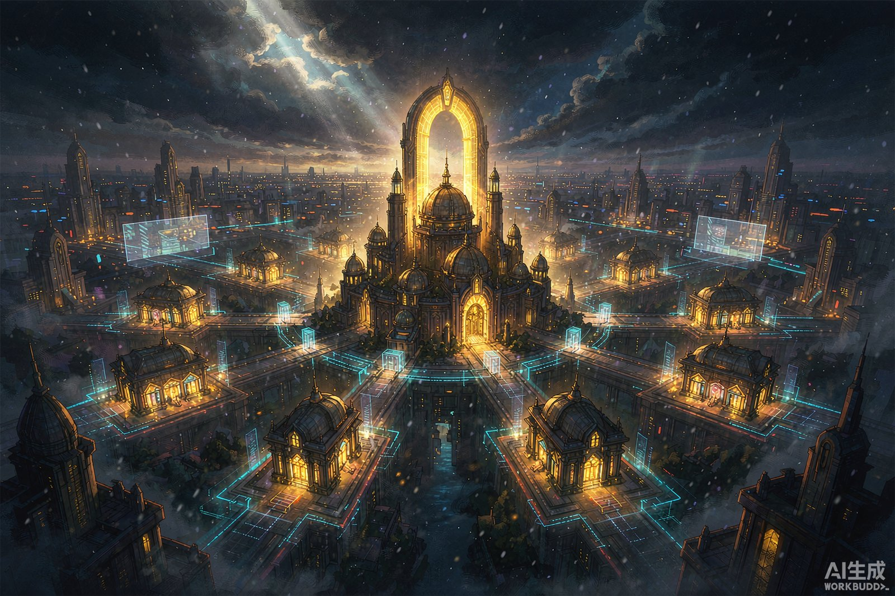
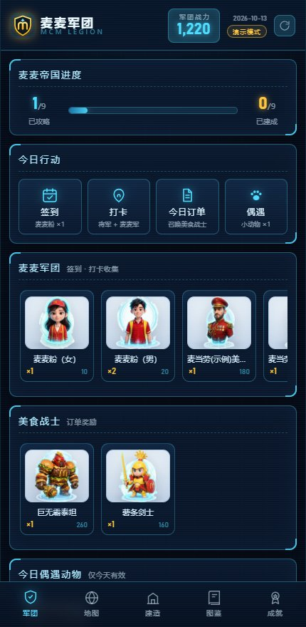
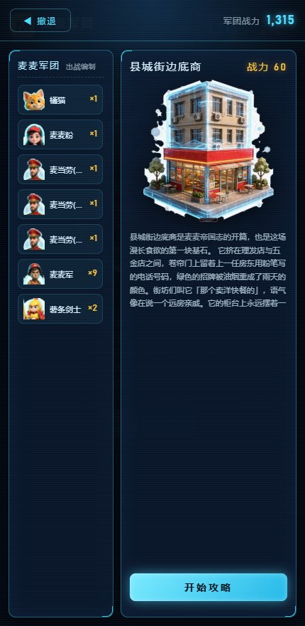
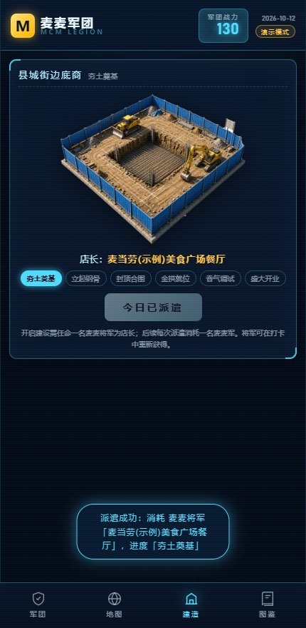
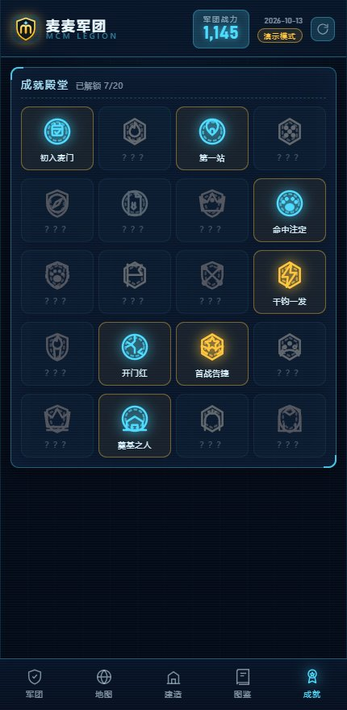

# 🍔 麦麦军团 MCM Legion

> 基于**麦当劳中国 MCP** 的收集 × 攻略 × 建设放置式游戏 Skill——
> 用你真实的到店打卡与当日订单，组建麦麦军团，攻陷九座竞争对手据点，再亲手把它们一座座建成麦麦据点，直到**麦麦帝国**的九座拱门同时亮起。



## ✨ 项目介绍

「麦麦军团」把麦当劳 MCP 的真实运营数据（附近门店、当日订单）转化为一套完整的游戏循环：

| MCP 真实数据 | 游戏要素 |
|---|---|
| `query-nearby-stores` 附近/收藏门店 | **打卡**：收集以门店命名的「麦麦将军」+「麦麦军」 |
| `order-list` 当日订单 | **订单奖励**：每笔订单兑换 1 名随机「美食战士」 |
| 每日登录 | **签到**得麦麦粉、**偶遇**得小动物（仅当天有效） |

玩家收集军团战力 → 按顺序攻略 9 个竞争对手据点（每据点 5 个损毁阶段）→ 据点完全损毁后解锁**建设任务**（6 个步骤，每日派遣 1 次）→ 9 座麦麦据点全部建成即建立麦麦帝国。

游戏内置完整剧情：11 名军团角色的魔幻现实主义列传、10 只小动物（每只都有专属名字）的温馨治愈故事、9 座据点的魔幻现实主义志异，全部可在游戏内卡片详情中阅读。

### 麦麦军团成员

- **麦麦粉**（签到获得）／**麦麦军**（打卡获得）／**麦麦将军**（打卡获得，以门店命名，战斗免疫损毁）
- **美食战士 ×8**：薯条剑士、麦辣鸡腿堡战士、可乐枪炮兵、麦旋风法师、早餐麦满分守卫、咖啡苦行僧、巨无霸泰坦、黄金拱门守卫（订单奖励获得）
- **小动物 ×10**（每只均有专属名字）：哈士奇「白围巾」、萨摩耶「月牙」、金毛「老接」、柯基「贴地飞」、柴犬「守锅」、橘猫「落日」、奶牛猫「补丁」、灰虎斑「活地图」、白猫「信纸」、黑猫「夜巡」（每日偶遇，仅当天有效）

### 九座攻略据点（按顺序解锁）

县城街边底商 → 极窄炸鸡档口 → 街边茶饮档口 → 玻璃快取亭 → 街角玻璃便利店 → 中式仿古小楼 → 停车场独栋大店 → 披萨休闲餐厅 → 独栋快餐店

难度曲线保证**第一天即可攻略完第一个据点**；此后据点战力约为前者的 1.5~2 倍，全部通关约需两周以上的每日游玩（自检脚本实测 13 天自然收入通关）。

## 🚀 安装方法

```bash
# 要求 Node.js >= 22.5（使用内置 node:sqlite，零运行时依赖）
git clone <你的仓库地址> mcd-pk && cd mcd-pk

# 可选：安装 MCP SDK（不安装则运行在演示模式，游戏全流程可玩）
npm install

# 可选：配置麦当劳 MCP Token 启用真实数据（不配置则使用内置演示数据）
cp .env.example .env   # 编辑 .env 填入 MCD_MCP_TOKEN
```

```bash
npm start               # 启动游戏 → http://localhost:3210
npm run demo            # 命令行演示完整流程（独立存档）
npm run cli             # 命令行交互游玩
npm run check:game      # 游戏逻辑自检（92 项）
npm run check:web       # Web 界面冒烟测试（14 项，需 playwright）
```

> **美术资源**：`raw/` 下为 86 张原始大图（约 3MB/张），由脚本生成 Web 用资产：
> `assets/` 立绘与据点图（据点/建设 384px、角色/动物 320px，共 3.6MB）+
> `assets/avatars/` 128px 头部特写头像（22 张共 196KB，供出战编制等小图标位）。
> 重新生成：`pip install pillow && npm run assets && npm run assets:avatars`。

## 🎮 使用示例

1. **打开** http://localhost:3210 ，顶栏显示军团徽章 LOGO、军团总战力与数据模式（演示模式 / MCP 实时）。
2. **每日行动**：签到（麦麦粉×1，随机男女）→ 打卡（选附近门店，得将军+麦麦军）→ 订单奖励（每单召唤 1 名美食战士）→ 偶遇（1 只当天有效的小动物，每只都有专属名字）；每次行动都会弹出收获详情。
3. **攻略**：「地图」页左右箭头浏览 9 个据点，战力高于据点时「进入攻略」；战斗分 5 阶段，据点图像从「完好无损」逐阶段变为「完全损毁」，战斗日志同步播放六阶段损毁描述，每阶段军团损失约 30% 战力（将军与动物免疫）；战力不足会被迫撤退，损毁进度保留，可改日续攻；攻略完成后按钮变为「攻略完成」。
4. **建设**：据点完全损毁后解锁建设，开启需任命 1 名麦麦将军为**店长**，后续每次派遣消耗 1 名麦麦军，共 6 步（夯土奠基 → 盛大开业），每日限派遣 1 次；建造面板展示每一步的阶段描述。
5. **图鉴**：动物图鉴（10 只，一行 4 个网格）、打卡地（门店打卡记录）、据点图鉴（已攻略据点的 6 段损毁场景）。
6. **详情弹层**：点击军团卡片查看角色/动物介绍（含完整故事文案），所有弹层均可按 **Esc** 或点「关闭」按钮关闭。
7. **成就**：「成就」页查看 20 枚徽章（日常/军团/攻略/建设/终章五组）的收集进度，达成条件时弹出解锁庆典，可点击徽章查看条件与彩蛋文案。






## 👥 目标用户

- **麦当劳会员与麦门玩家**：把日常签到、打卡、点单变成可视化的收集与征战进度；
- **放置/收集游戏爱好者**：每天 5 分钟的轻量循环 + 长线帝国建设目标；
- **MCP 开发者**：一个「真实数据 → 游戏要素」的完整参考实现，可复用到其他生活化游戏场景。

## 🏗️ 技术栈与结构

- **后端**：Node.js 原生 HTTP 服务（`server.mjs`），零框架；本地数据库使用内置 `node:sqlite`（SQLite WAL 模式）
- **MCP**：`@modelcontextprotocol/sdk` StreamableHTTP 客户端，动态 import，未安装不影响启动
- **前端**：Vue 3（本地化 `public/vendor/vue.global.prod.js`，无外部网络依赖），全息指挥地图 UI 风格
- **美术**：`raw/` 原始大图 → `scripts/build-assets.py`（Pillow 裁切/缩放/256 色量化）→ `assets/` Web 资产；`scripts/build-avatars.py` 另切 128px 头像；`scripts/compress-docs.py` 压缩文档配图

```
mcd-pk/
├── README.md                 项目介绍（本文件）
├── CONTEST_DECLARATION.md    参赛声明（官方原文，不可改动）
├── MCP_INTEGRATION.md        MCP 集成说明
├── SKILL.md                  WorkBuddy Skill 说明
├── server.mjs                Web 服务器 + REST API
├── package.json
├── src/
│   ├── cli.mjs               命令行游玩入口
│   ├── mcp/mcdApi.js         麦当劳 MCP 客户端（含离线演示兜底）
│   ├── store/                SQLite 表结构与存储层
│   └── game/
│       ├── config.js         全部游戏数值（调平衡改这里）
│       ├── story.js          全部剧情文案（角色/动物/据点/终章）
│       ├── engine.js         游戏引擎（签到/打卡/订单/偶遇/攻略/建设/图鉴/成就）
│       ├── achievements.js   20 枚成就定义与徽章
│       └── rng.js            带种子的确定性随机
├── scripts/
│   ├── build-assets.py       美术资产生成（立绘/据点/建设）
│   ├── build-avatars.py      头像生成（128px 头部特写）
│   ├── compress-docs.py      文档配图压缩（PNG→JPEG）
│   ├── checkgame.mjs         游戏逻辑自检（92 项）
│   └── smoke-web.mjs         Web 冒烟测试（14 项）
├── assets/                   角色/动物/据点 6 阶段/建设 6 阶段图像
│   └── avatars/              22 张 128px 头部特写头像
├── public/                   Vue 单页应用（全息 UI）
└── docs/
    ├── hero-mcm-empire.jpg    首图主视觉（麦麦帝国全景）
    ├── 游戏玩法设计.md        完整玩法设计文档
    ├── 剧情设定集.md          全部剧情文案
    ├── 数据存储方案.md        存储设计与防作弊
    ├── ui-styles/            三套 UI 风格方案图
    └── screenshots/          游戏实机截图
```

## 🔒 数据与隐私

- 玩家进度仅存本地 `data/mcm-legion.db`（已 gitignore），不上传任何服务器；
- MCP Token 只从 `.env` 环境变量读取，仓库仅保留 `.env.example` 占位符；
- 对 MCP 只有**只读查询**（门店、订单），无任何写操作/支付行为；
- 随机都在本地完成且不消耗真实积分或麦当劳权益：订单战士按**订单 ID** 确定性随机（同一笔订单永远对应同一位战士，重复领取不会刷出新人），偶遇动物与签到麦麦粉性别为**真随机**（同一天重置重玩也会遇到不同动物）。

## 📄 参赛作品说明

本项目为「麦当劳程序员节创意开发大赛」参赛作品，由参赛者独立开发，非麦当劳官方产品。赛事规则见 [mcd-developer-innovation-challenge](https://github.com/M-China/mcd-developer-innovation-challenge)。
